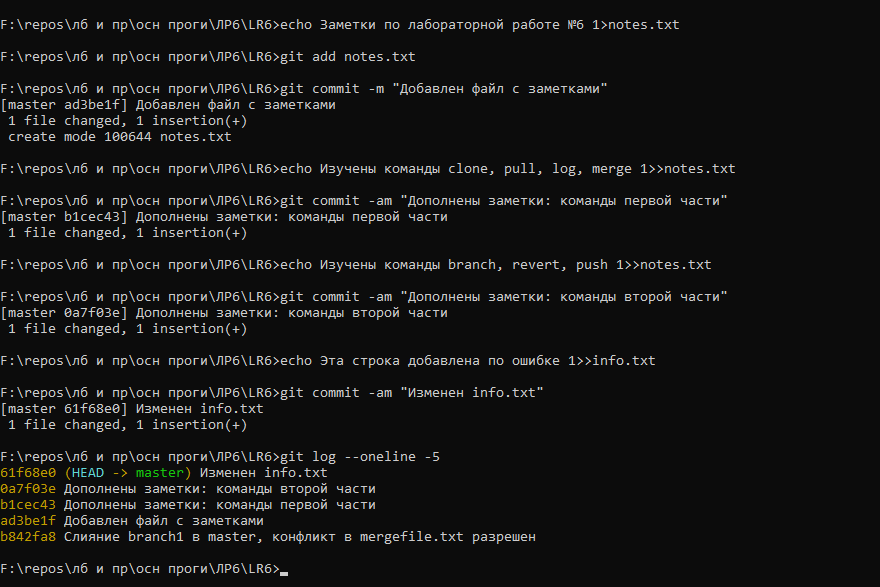
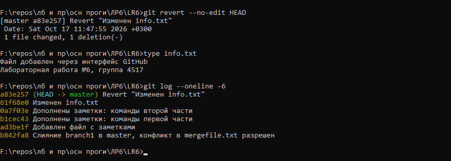
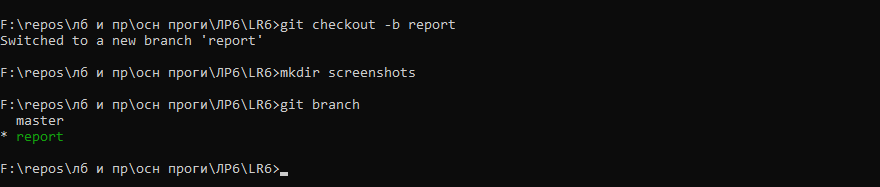

# Лабораторная работа №6. Система контроля версий

Выполнил: Федоров Е.В., группа 4517

Цель работы: изучить базовые возможности Git, поработать с локальным и удаленным репозиторием.

## 1. Аккаунт и форк

Аккаунт на GitHub у меня уже был (egorthinks). Репозиторий https://github.com/Kurtyanik/LR6 я форкнул к себе, получился https://github.com/egorthinks/LR6. В форк попали обе ветки: master и branch1.

## 2. Настройка Git и клонирование

Git был установлен заранее (версия 2.52). Склонировал свой форк и задал имя и email. Имя по заданию в формате «Группа Фамилия И.О.». Настройки задал для этого репозитория, чтобы не трогать глобальный конфиг, которым я пользуюсь в других проектах.


## 3. Файл через интерфейс GitHub

На сайте нажал Add file, создал файл info.txt и закоммитил его прямо в master.


Потом подтянул это изменение в локальный репозиторий через `git pull`. Прошло как fast-forward, так как локально я еще ничего не менял.


## 4. История веток и последние изменения

Посмотрел историю каждой ветки через `git log --oneline --graph`. У master и branch1 общие первые два коммита, дальше они расходятся: в master «Обновление информации» и мой info.txt, в branch1 «Заполнил файл».


Последние изменения посмотрел через `git show --stat HEAD`, а разницу между ветками через `git diff`. Видно, что обе ветки по-разному меняют mergefile.txt, так что при слиянии будет конфликт.


## 5. Слияние с конфликтом

Сливаю branch1 в master. Git сообщает о конфликте в mergefile.txt и расставляет в файле маркеры `<<<<<<<`, `=======` и `>>>>>>>`.


Конфликт разрешил вручную в текстовом редакторе: убрал маркеры и объединил обе версии в одну осмысленную фразу. После этого `git add` и коммит слияния.


## 6. Удаление побочной ветки

После слияния ветка branch1 больше не нужна, удалил ее через `git branch -d`. Ключ `-d` удаляет ветку только если она уже слита, так что ничего не потеряется.


## 7. Коммиты и откат

Сделал несколько изменений и после каждого коммит с комментарием: завел файл notes.txt, два раза его дополнил и еще изменил info.txt.



Последний коммит (строка в info.txt) оказался лишним, поэтому откатил его через `git revert`. В отличие от `git reset`, revert не переписывает историю, а создает новый коммит с обратными изменениями. Для ветки, которая потом уйдет на GitHub, это безопаснее.



## 8. Ветка для отчета

Создал ветку report и папку screenshots под скриншоты. Этот отчет пишу уже в ней и периодически коммичу.



## Лог команд

```
git clone https://github.com/egorthinks/LR6.git
cd LR6
git config user.name "4517 Федоров Е.В."
git config user.email "egor.fedorov.contact@gmail.com"
git config user.name
git config user.email
git branch -a
git pull
git log --oneline -3
git checkout branch1
git log --oneline --graph
git checkout master
git log --oneline --graph
git show --stat HEAD
git diff master origin/branch1
git merge branch1
git status
git add mergefile.txt
git commit -m "Слияние branch1 в master, конфликт в mergefile.txt разрешен"
git branch -d branch1
git branch -a
git add notes.txt
git commit -m "Добавлен файл с заметками"
git commit -am "Дополнены заметки: команды первой части"
git commit -am "Дополнены заметки: команды второй части"
git commit -am "Изменен info.txt"
git log --oneline -5
git revert --no-edit HEAD
git log --oneline -6
git checkout -b report
git branch
git add README.md screenshots
git commit -m "..."
git log --pretty=format:"%h %ad %an %s" --date=short
git push -u origin report
git push origin master
git push origin --delete branch1
```
