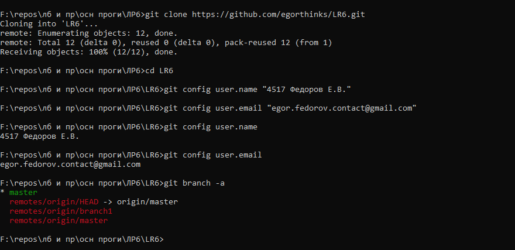
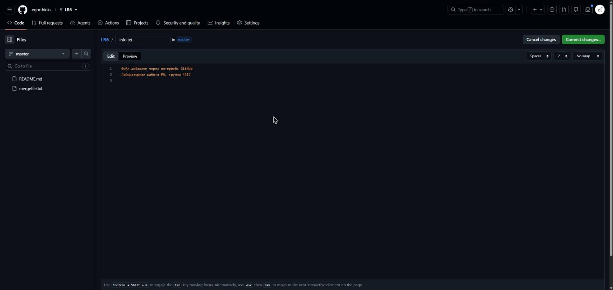
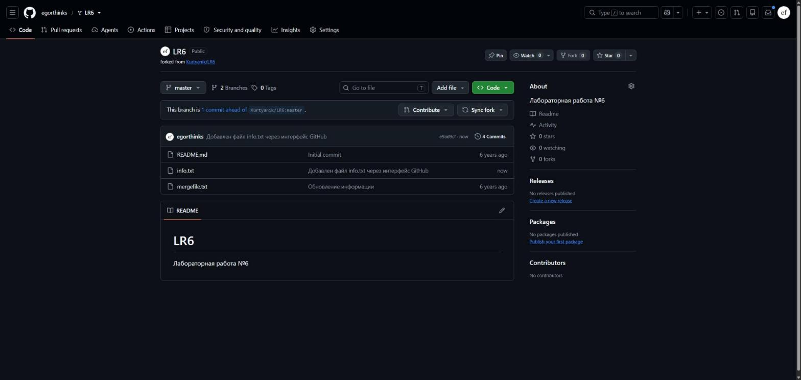
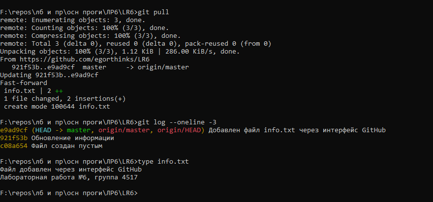
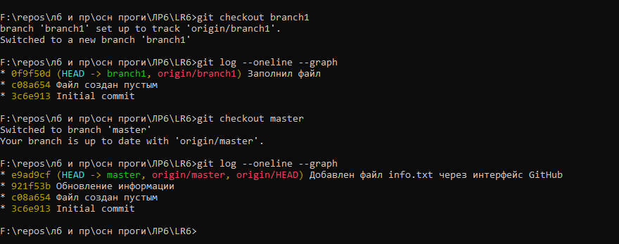
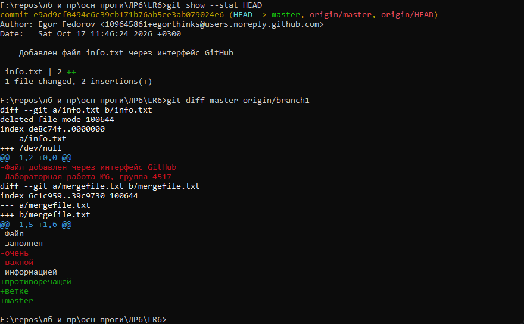
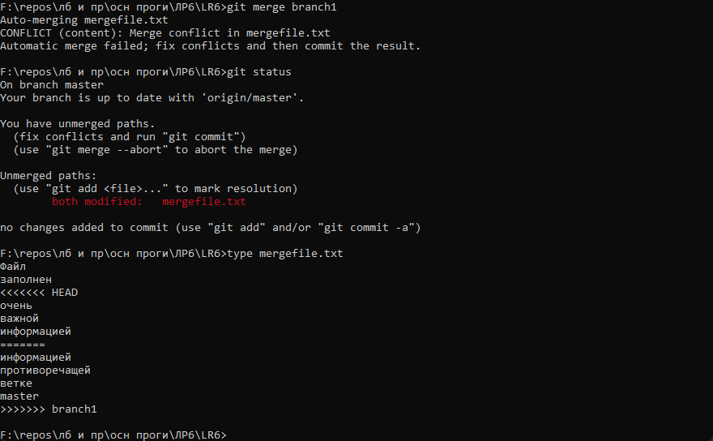
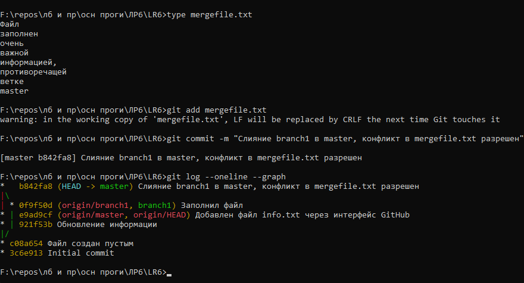
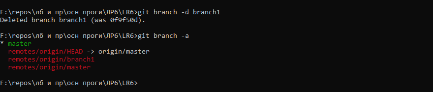

# Лабораторная работа №6. Система контроля версий

Выполнил: Федоров Е.В., группа 4517

Цель работы: изучить базовые возможности Git, поработать с локальным и удаленным репозиторием.

## 1. Аккаунт и форк

Аккаунт на GitHub у меня уже был (egorthinks). Репозиторий https://github.com/Kurtyanik/LR6 я форкнул к себе, получился https://github.com/egorthinks/LR6. В форк попали обе ветки: master и branch1.

## 2. Настройка Git и клонирование

Git был установлен заранее (версия 2.52). Склонировал свой форк и задал имя и email. Имя по заданию в формате «Группа Фамилия И.О.». Настройки задал для этого репозитория, чтобы не трогать глобальный конфиг, которым я пользуюсь в других проектах.

## 3. Файл через интерфейс GitHub

На сайте нажал Add file, создал файл info.txt и закоммитил его прямо в master.

Потом подтянул это изменение в локальный репозиторий через `git pull`. Прошло как fast-forward, так как локально я еще ничего не менял.

## 4. История веток и последние изменения

Посмотрел историю каждой ветки через `git log --oneline --graph`. У master и branch1 общие первые два коммита, дальше они расходятся: в master «Обновление информации» и мой info.txt, в branch1 «Заполнил файл».

Последние изменения посмотрел через `git show --stat HEAD`, а разницу между ветками через `git diff`. Видно, что обе ветки по-разному меняют mergefile.txt, так что при слиянии будет конфликт.

## 5. Слияние с конфликтом

Сливаю branch1 в master. Git сообщает о конфликте в mergefile.txt и расставляет в файле маркеры `<<<<<<<`, `=======` и `>>>>>>>`.

Конфликт разрешил вручную в текстовом редакторе: убрал маркеры и объединил обе версии в одну осмысленную фразу. После этого `git add` и коммит слияния.

## 6. Удаление побочной ветки

После слияния ветка branch1 больше не нужна, удалил ее через `git branch -d`. Ключ `-d` удаляет ветку только если она уже слита, так что ничего не потеряется.

